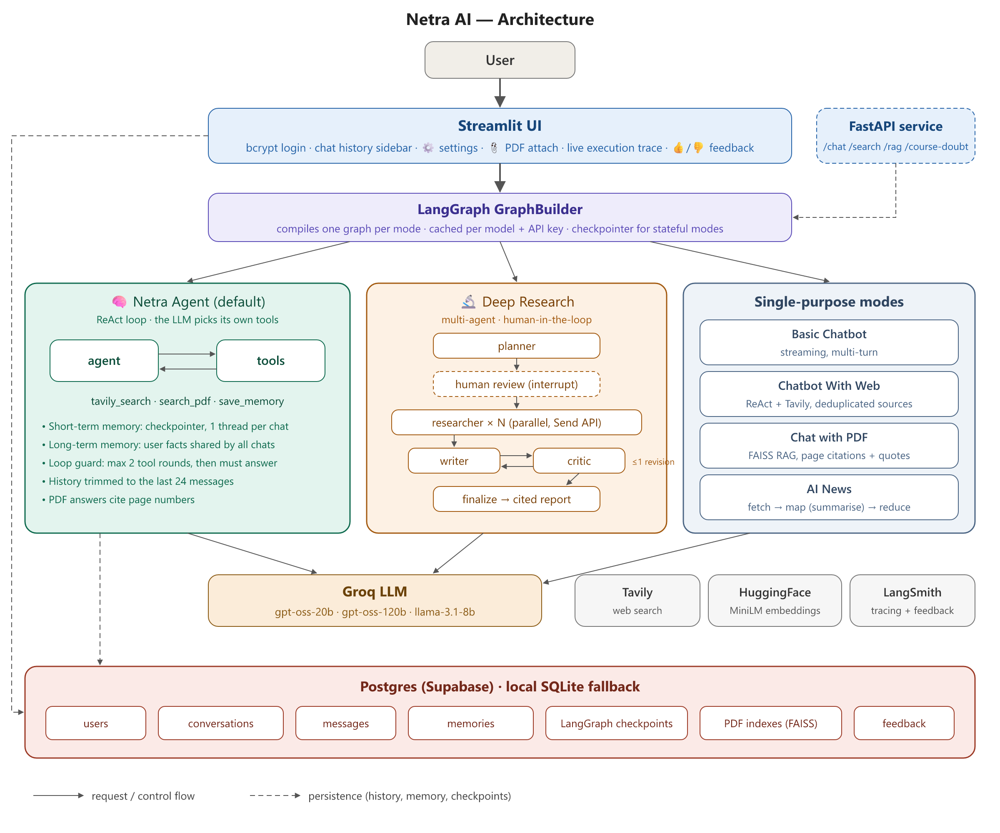

<p align="center">
  
</p>

<h1 align="center">Netra AI</h1>
<p align="center"><em>See Beyond. — Stateful Agentic AI powered by LangGraph + Groq</em></p>

<p align="center">
  
  
  
  
  
  <a href="https://github.com/Somyabhawsar45/Agentic-Chatbot/actions/workflows/tests.yml"></a>
  
  <a href="https://netra-agentic-ai.streamlit.app"></a>
</p>

---

## 🔗 Live Demo
[netra-agentic-ai.streamlit.app](https://netra-agentic-ai.streamlit.app) — no API key needed (demo key with a daily message limit; add your own Groq key in ⚙ Settings for unlimited use).

## 🚀 Features
- 🧠 **Netra Agent (default)** — One agent that decides on its own whether to answer directly, search the web (Tavily) or search your attached PDF (FAISS RAG), looping through tools ReAct-style
  - **Real LangGraph memory** — compiled with a checkpointer (Postgres or SQLite); each conversation is a `thread_id`, so only the new message is sent and LangGraph restores the full history (incl. tool calls) itself. History is trimmed to recent turns to fit the context window
  - **Long-term memory across chats** — the agent calls a `save_memory` tool when you share lasting facts ("Name is Somya", "prefers short answers") and recalls them in *every* conversation; view or delete them in the sidebar's 🧠 Memory panel
  - **Loop guard** — at most 2 tool rounds per question, then the model is forced to answer (`tool_choice="none"`)
  - **Live execution trace** — every node, tool call (with arguments), tool result size and step timing, streamed as it happens
- 🔬 **Deep Research (multi-agent + human-in-the-loop)** — a planner splits the topic into sub-questions, the graph **pauses (`interrupt`) so you can edit/approve the plan**, then **parallel researcher agents** (LangGraph `Send` API) search and take notes, a writer drafts a cited report and a critic reviews it (one revision loop). Reports download as Markdown
- 👍 **Feedback loop** — rate any answer; ratings are stored and attached to the exact LangSmith run
- 🎨 **Premium UI** — black + electric-blue design system, message cards, starter prompts per mode, 📎 PDF attach inside the chat box, grouped & searchable history with rename, settings popover, chat export
- 📄 **Chat With PDF** — RAG with FAISS + HuggingFace embeddings; answers cite **page numbers**, and a "From your PDF" box shows the exact passages used
- 🌐 **Web Search** — Tavily + ReAct agent (LLM decides when to search), with a deduplicated Sources box
- 📰 **News Summary** — Map-Reduce summarization across multiple sources
- 🤖 **Basic Chatbot** — Multi-turn conversation, answers stream token-by-token
- 🔐 **User Authentication** — bcrypt password hashing; private, per-user chat history (ChatGPT-style sidebar)
- ☁️ **Persistent cloud storage** — users, chats, agent memory and PDF indexes in Postgres (Supabase), so nothing resets when the app restarts. Falls back to a local SQLite file when no database URL is set
- 📈 **Observability** — LangSmith tracing of every graph run, labelled by feature, user and conversation
- 🧪 **Tested** — offline pytest suite (fake LLM, temp DB) covering memory, tool routing, the loop guard, the multi-agent graph and storage; runs on every push via GitHub Actions

## 🏗 Architecture


```
Netra Agent:    START → agent ⇄ tools (tavily_search, search_pdf, save_memory) → END   [checkpointer = memory]
Deep Research:  START → planner → human_review (interrupt) ─Send×N→ researcher (parallel) → writer ⇄ critic → finalize → END
AI News:        START → fetch_news → summarize_news (map → reduce) → save_result → END
```

## 🛠 Tech Stack
| Layer | Tech |
|-------|------|
| Framework | LangGraph, LangChain |
| LLM | Groq (gpt-oss-20b / 120b, llama-3.1-8b) |
| Web Search | Tavily |
| Embeddings | HuggingFace Inference API (sentence-transformers/all-MiniLM-L6-v2) |
| Vector Store | FAISS (serialized into the database per conversation) |
| Memory | LangGraph checkpointer (PostgresSaver / SqliteSaver) |
| Database | Postgres (Supabase) or SQLite |
| Observability | LangSmith |
| Auth | bcrypt |
| Frontend | Streamlit |
| Tests / CI | pytest, GitHub Actions |

## ⚙ Setup Locally
```bash
git clone https://github.com/Somyabhawsar45/Agentic-Chatbot
cd Agentic-Chatbot
pip install -r requirements.txt
```
Add a `.env` file:
```
GROQ_API_KEY=your_key
TAVILY_API_KEY=your_key
HUGGINGFACEHUB_API_TOKEN=your_token          # Chat With PDF embeddings

# optional
DATABASE_URL=postgresql://...                # empty = local SQLite file
DAILY_MESSAGE_LIMIT=30                       # per user/day on the built-in Groq key
LANGSMITH_TRACING=true
LANGSMITH_API_KEY=your_langsmith_key
LANGSMITH_PROJECT=netra-ai
```
```bash
streamlit run app.py
```

### Run the tests
```bash
pip install -r requirements-dev.txt
pytest -q
```
No API keys needed — the tests use a fake LLM and a temporary database.

### Run the REST API (optional)
The same LangGraph graphs are also exposed through FastAPI:
```bash
uvicorn src.langgraphagenticai.api.main:app --reload
```
Endpoints live under `/api/v1` (`/chat`, `/search`, `/rag`, `/course-doubt`, `/index-course`), plus `/health`. Interactive docs at `http://localhost:8000/docs`.

## 📁 Project Structure
```
app.py                          # Streamlit entry point + login/sign-up
src/langgraphagenticai/
├── main.py                     # picks the mode, builds/caches the graph, daily limit
├── settings.py                 # .env / Streamlit secrets → environment
├── graph/graph_builder.py      # one LangGraph per mode
├── nodes/                      # Netra agent, Deep Research team, chatbot, PDF RAG, AI News, loop guard
├── tools/                      # tavily_search, search_pdf, save_memory
├── memory/checkpointer.py      # PostgresSaver / SqliteSaver
├── rag/pdf_rag_utils.py        # PDF → page-aware chunks → FAISS (stored in the DB)
├── database/db_utils.py        # users, conversations, messages, memories, feedback
├── api/                        # FastAPI service
└── ui/streamlitui/             # sidebar, chat rendering, theme
tests/                          # offline pytest suite
```

## ☁ Deploying (Streamlit Community Cloud)
Put the same keys in **App settings → Secrets** (TOML format, e.g. `GROQ_API_KEY = "..."`).

**Persistent database (free, Supabase):** create a project at supabase.com → **Connect** →
copy the **Session pooler** connection string → set it as `DATABASE_URL` (replace `[YOUR-PASSWORD]`).
Tables are created automatically on first start.

**LangSmith:** create an API key at smith.langchain.com and set `LANGSMITH_TRACING = "true"`,
`LANGSMITH_API_KEY` and `LANGSMITH_PROJECT`.

## 📄 License
MIT License — free to use, modify, and distribute.
